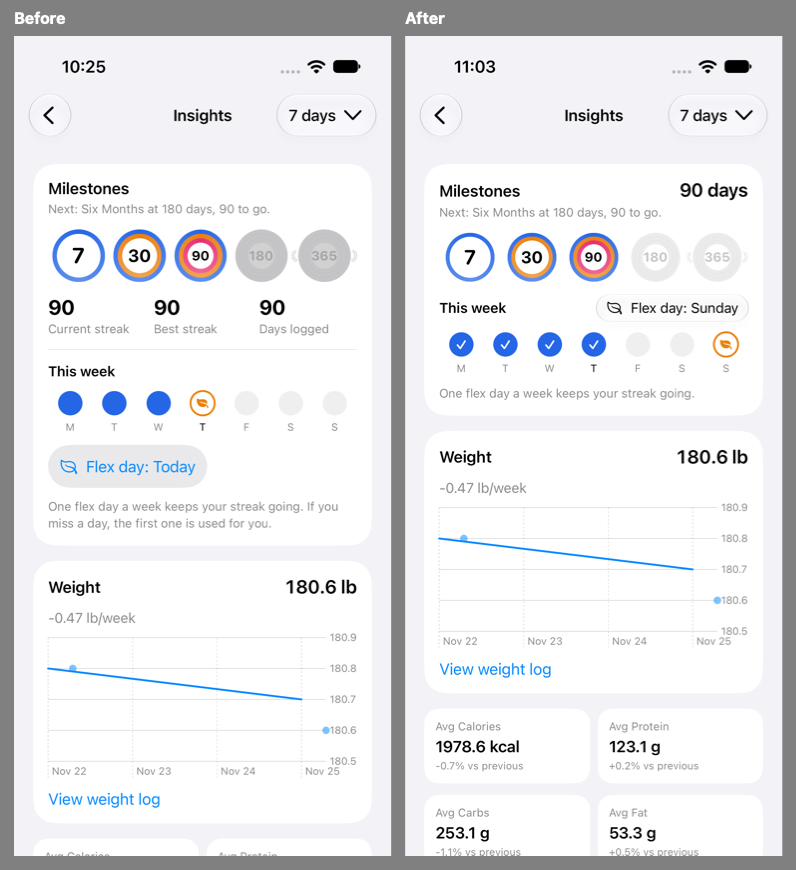
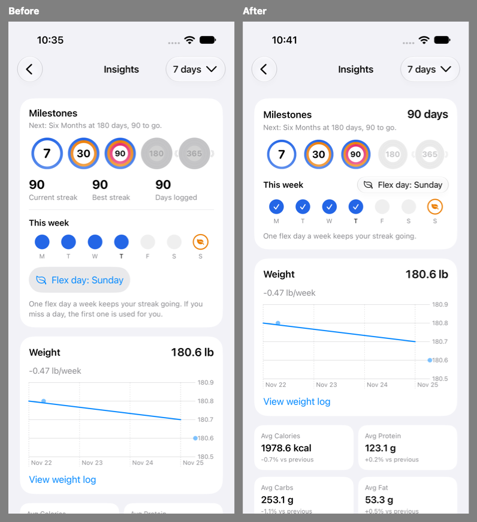
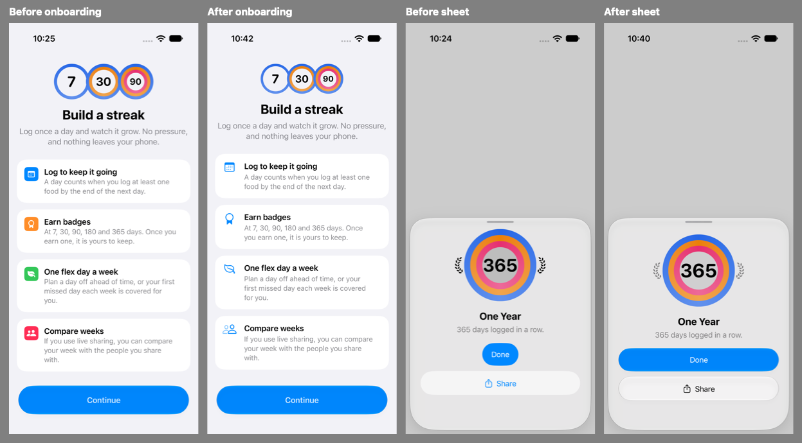
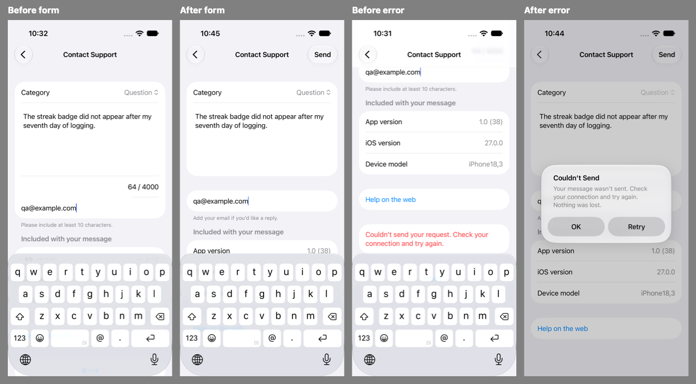
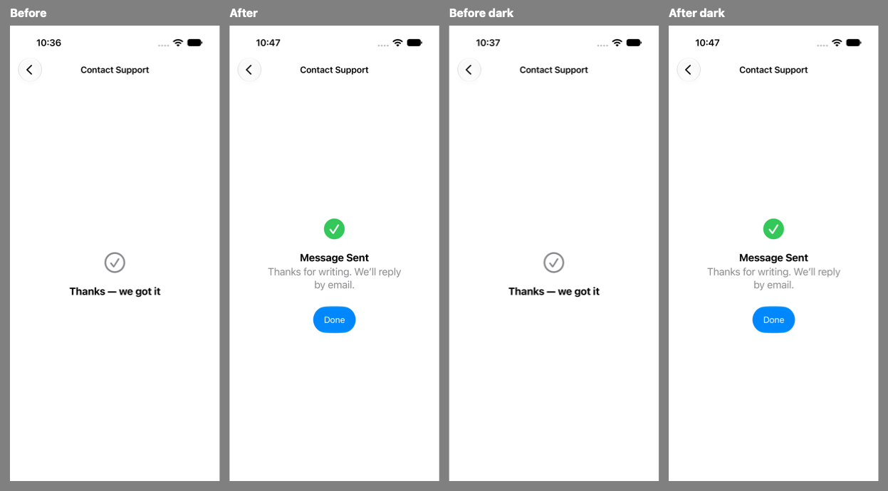

# Design pass, 2026-11-26: Streak Milestones and Contact Support

Owner feedback: Milestones looked out of place and not native Liquid Glass enough. iPhone 17 simulator, iOS 27.0, fixture data (no production data). Before = `feature/streak-milestones` @ `7e5e75a` and `feature/support-and-ratings` @ `36edcac`. After = `e2bf608` and `2df0e34`. Captured in light, dark and Accessibility XL; the five sheets below show the most telling states (light unless noted). Raw captures stay in ignored `build/evidence/` in the worktrees.

1. 
2. 
3. 
4. 
5. 

Sheet 2 is labelled dark in its file name but was captured light; dark after-captures were checked separately and read correctly.

## Critique

Method: design review only (native iOS, no detector). BEFORE captures: iPhone 17, iOS 27.0, fixture data, light / dark / Accessibility XL. Sources: streak branch `7e5e75a`, support branch `36edcac`. References compared: Insights Weight card, Settings, onboarding Choice / Goals / Reminders screens, Today, tutorial glass panel and finish card, Pro paywall, `BottomPinnedActionBar`, `errorBanner`.

## Streak Milestones

### Insights card
| # | Finding | Why it breaks consistency / native feel | Fix | Pri |
|---|---|---|---|---|
| 1 | Five 56 pt medallions with full-colour concentric rings, locked ones as grey filled discs with tiny laurels | Reads as stickers. Weight card is plain content on the card; rings elsewhere are a glass track with a gradient arc, never grey fills | Locked = single thin tertiary track and tertiary numeral, no fill; laurels only when earned; earned uses the app ring track + round-cap gradient | P1 |
| 2 | Stat row 90 / 90 / 90 | Three equal numbers carry one fact; Weight card leads with one value top-right | One headline value top-right ("90 days", same `title3.bold` as Weight); "Best" and "logged" appear only when they differ from the current streak | P1 |
| 3 | Grey bordered capsule "Flex day: Today" under the dots | A grey bordered button is neither the app's glass control nor a system menu look; state is a label only | Native `Menu` with `.buttonStyle(.glass)` (same style as tutorial / camera glass buttons), placed in the "This week" header row; label shows the chosen day | P1 |
| 4 | Week dots: colour is the only difference between logged / missed / future | Fails "not colour alone"; flex leaf is the only shape cue | Logged = check, flex = leaf, missed = empty ring, future = faint dot; VoiceOver label unchanged ("Monday, Logged") | P2 |
| 5 | Three text sizes of grey footnote + subtitle + footnote | More copy than any other Insights card | Keep subtitle ("Next: ..."), shorten the flex footnote to one sentence | P3 |

### Today streak line
Subtle and native already. Fix: 28 pt tall hit target (HIG 44 pt), hierarchical rosette symbol. P2.

### Celebration sheet
| Finding | Fix | Pri |
|---|---|---|
| Medallion touches the drag indicator at the medium detent | More top padding | P2 |
| `borderedProminent` rounded-rect Done and `bordered` Share; every other action surface (tutorial, camera, share, bottom bar) is a glass capsule | `.glassProminent` Done, `.glass` Share inside a `GlassEffectContainer` | P1 |
| Haptic, Reduce Motion (ring fills instantly) and detent already match other sheets | No change | - |

### Onboarding streaks screen
| Finding | Fix | Pri |
|---|---|---|
| Four rows use four arbitrary tile colours (blue/orange/green/pink) with white square icons; Choice and Goals screens use tinted hierarchical symbols, one accent | Same row anatomy as `OnboardingChoiceScreen`: accent hierarchical symbol, `.headline` + secondary `.subheadline` | P1 |
| Hero medallions at a fixed 76 pt with heavy fills | Same medallion fix, scaled metric, smaller overlap | P2 |
| At AX text sizes the page is only a scroll of large body text (same `OnboardingHeader` as every step, so intentional); the first card is clipped under the pinned bar by design of the fade | Rows stack vertically at AX (already), trim copy so fewer lines | P3 |

## Contact Support
| # | Finding | Fix | Pri |
|---|---|---|---|
| 1 | Send is the last Form row; hidden behind the keyboard, needs scroll + dismiss | Toolbar `confirmationAction` "Send" (spinner while sending), always reachable | P0 |
| 2 | "Please include at least 10 characters." always shown, even when valid | Footer only while invalid, and says which field is wrong | P1 |
| 3 | `0 / 4000` counter row is a full row of grey text | Counter only appears near the limit, as footer text | P2 |
| 4 | Error is red text in its own section; Send turns into "Retry" | Existing `errorBanner` alert with Retry action; form content is preserved | P1 |
| 5 | Success: grey checkmark and "Thanks — we got it", no explanation, no exit | `ContentUnavailableView`: green check, "Message Sent", explains reply by email (or none), "Done" glass button that pops back | P0 |
| 6 | Empty TextEditor has no prompt | Placeholder "How can we help?" | P3 |
| 7 | Email field has no explanation of why | Section footer: "Optional. Add it if you'd like a reply." | P3 |

Not changed: Form (native Settings pattern), category Picker, "Included with your message" rows, Help link, validation and request code, tests.

