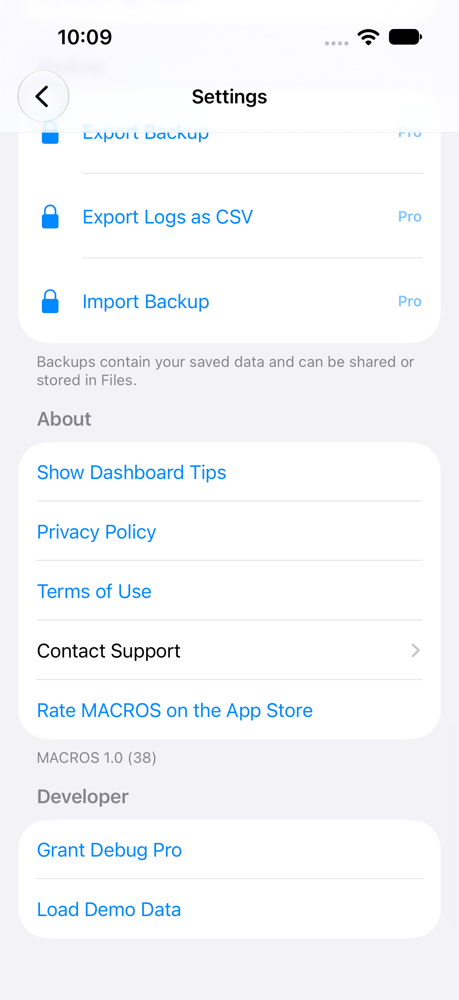
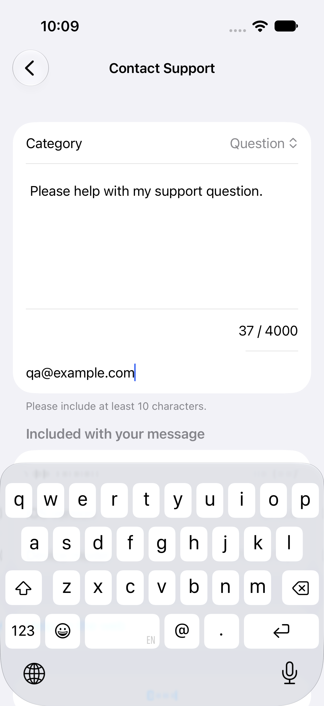
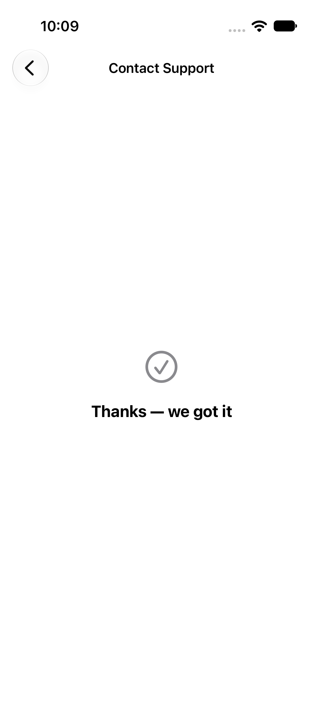
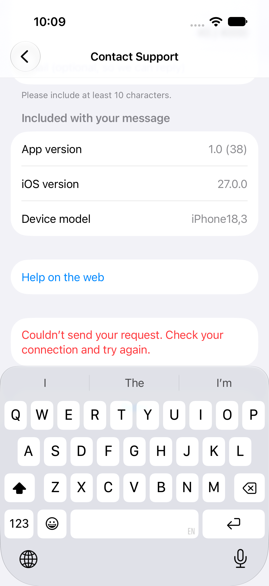
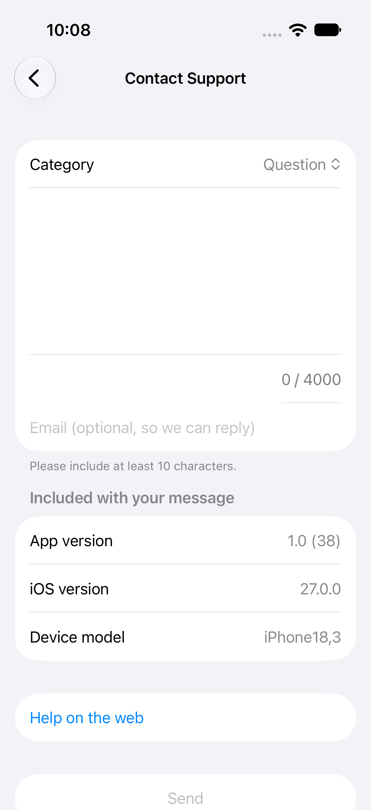

# Support form QA (2026-11-26)

Source: `feature/support-and-ratings` at `36edcac` (validated production changes). Xcode 27.0, iOS 27.0, iPhone 17 simulator. UI tests used the in-memory fixture and a loopback HTTP stub or an intentionally unreachable local port. No production support endpoint was contacted.

## Reproduction

From the support feature worktree, run the `cal-macro-tracker` scheme with `-only-testing:cal-macro-trackerTests/SupportRequestClientTests -only-testing:cal-macro-trackerTests/ReviewPromptEligibilityTests test`. The UI scenarios used temporary fixture-backed tests with `MACROS_SUPPORT_ENDPOINT` set to a local HTTP stub, then to `http://127.0.0.1:1/v1/requests`; that harness was removed after capture. Expected: the stub send succeeds, the unreachable endpoint shows an error without clearing the message, and Accessibility 3 remains usable.

## Results

- `SupportRequestClientTests` and `ReviewPromptEligibilityTests`: 5/5 passed. The review-eligibility test fixture now uses prompted version `1.1`, matching the current app version and exercising the version-spacing rejection.
- Three support UI tests passed: successful local-stub send, unreachable-endpoint error with message retained, and Accessibility 3 layout.
- Support request metadata now reports the simulator model identifier (`iPhone18,3`) instead of the simulator process architecture (`arm64`). The label was verified in the accessibility hierarchy and screenshot.
- Five captures were visually inspected and total less than 2 MiB.
- No blocking cases remained in this validation.

## Captures

- Settings and Contact Support entry: 
- Filled form: 
- Successful local-stub submission: 
- Unreachable endpoint error: 
- Accessibility 3 layout: 

Raw XCTest results and attachments remain in ignored `build/evidence/2026-11-26-support/` in the validation worktree.
