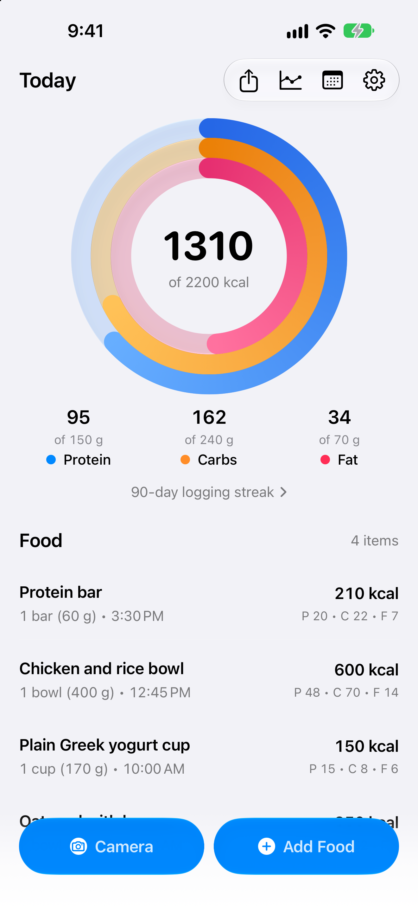
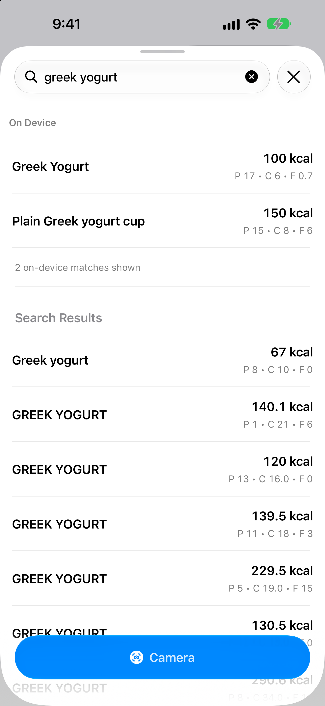
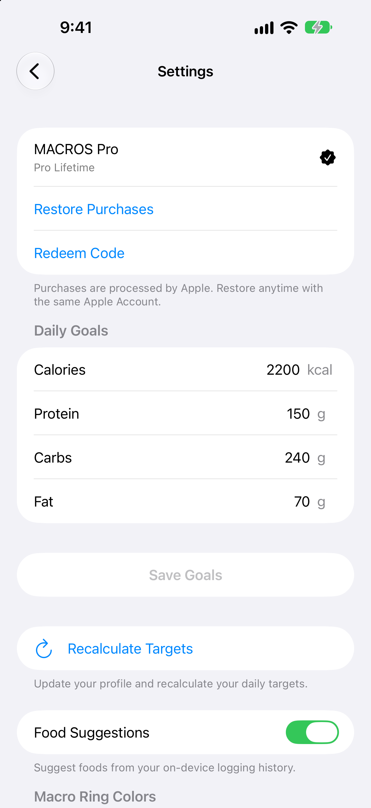
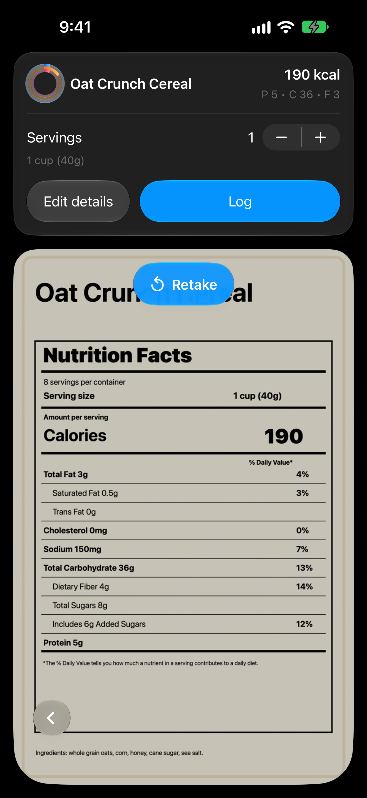
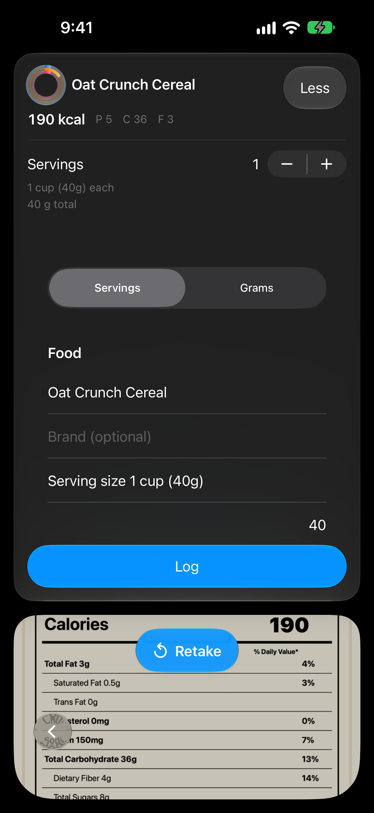
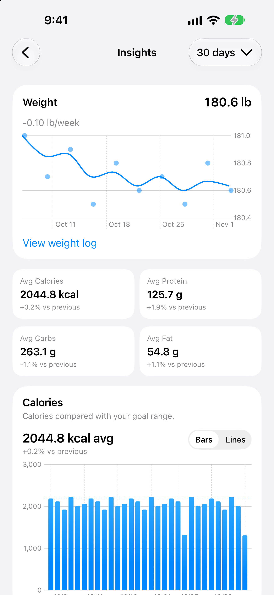
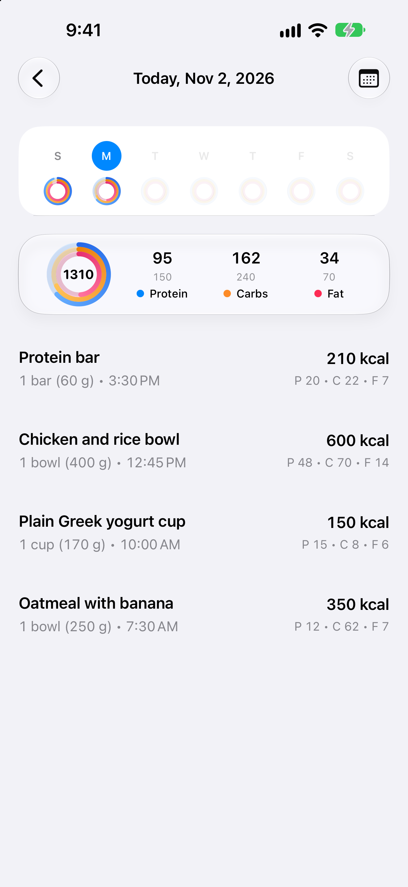
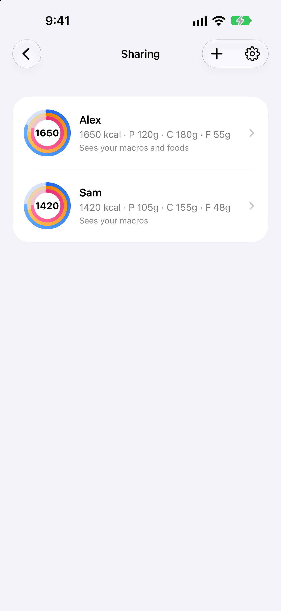
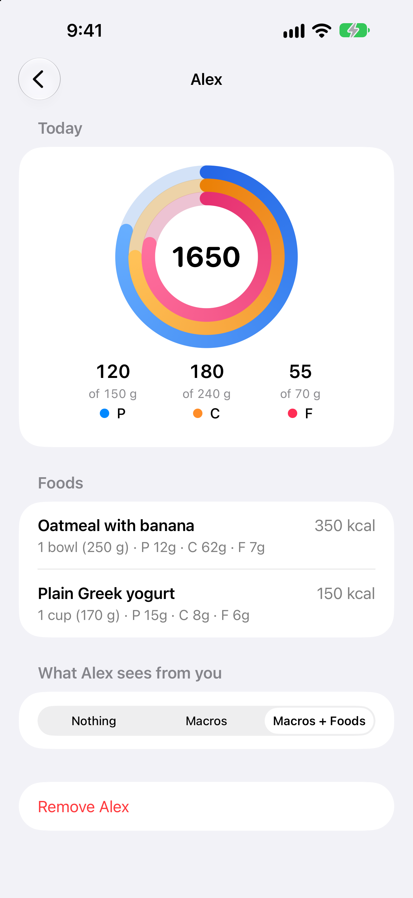
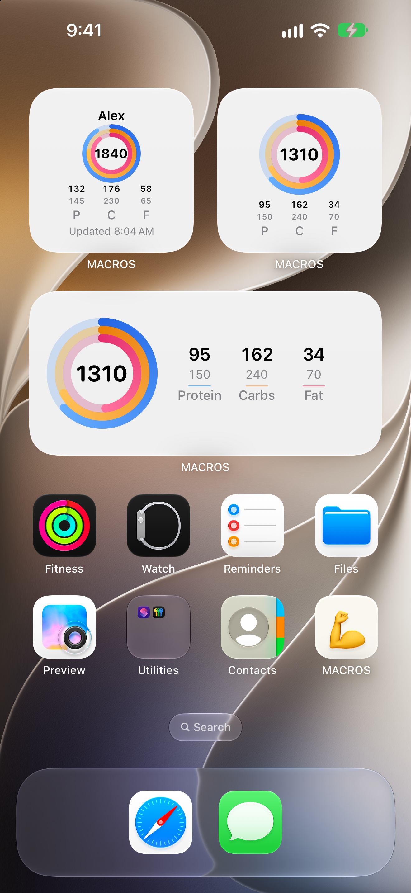

# MACROS

MACROS is a local-first calorie and macro tracker for iPhone, with a small supporting web and backend surface.

- `cal-macro-tracker/` — the native iPhone app with widgets
- `convex-backend/` — the optional sharing backend
- `worker/auth/` — the auth worker used by sharing
- `worker/usda-proxy/` — the food-search API worker
- `web/` — the product, privacy, waitlist, and support site
  - <https://macros-web.jhonra121.workers.dev/>

The app stays local-first: no required account for normal tracking, on-device food/log data by default, and optional network features layered on top for invite sharing and food search.

## Screenshots

### Home

  

### Logging

  

### Settings

  

### Label review

  
  &nbsp;&nbsp;
  

### Insights

  

### History

  

### Sharing

  
  &nbsp;&nbsp;
  

### Widgets

  

## Features

- **Dashboard** — daily calorie and macro progress, logged foods, quick edits, and shareable summaries
- **Food logging** — log common foods, saved foods, searched foods, custom foods, suggestions, or manual entries, with servings/grams math handled deterministically
- **Scanning** — barcode scanning and nutrition-label scanning, including camera/photo fallback paths and editable review before logging
- **Search and suggestions**: one food-search list with on-device matches and search results as you type, saved-food suggestions, and saved reusable foods
- **History** — calendar-based browsing of past days and weekly progress
- **Insights** — premium nutrition graphs and trends for calories, macros, consistency, and goal progress
- **Sharing dashboard** — optional no-account sharing with Convex-backed invite links, shared macro rings, today's totals, per-person controls, and revocation/delete flows
- **Widgets**: Home Screen and Lock Screen widgets for your macros, plus shared-person widgets with MACROS Pro
- **Settings**: daily goals, saved foods, macro ring colors, sharing, preferences, and MACROS Pro purchase/restore
- **MACROS Pro**: yearly, monthly, and lifetime plans; the legacy Full Unlock non-consumable remains supported
- **Offline-first** — local persistence, cached lookups, and graceful network absence

## Workspace Overview

| Path | Stack | Purpose |
|---|---|---|
| `cal-macro-tracker/` | SwiftUI, SwiftData, WidgetKit, StoreKit, Convex | Native iPhone calorie and macro tracking app |
| `convex-backend/` | Convex, TypeScript, Bun | Optional sharing backend for invite-based macro dashboard sharing |
| `worker/auth/` | Cloudflare Workers, Hono, TypeScript, Bun | Auth and invite-link worker for sharing |
| `worker/usda-proxy/` | Cloudflare Workers, Hono, TypeScript, Bun | Food-search API worker |
| `web/` | Astro, Cloudflare, TypeScript, Bun, D1 | Product site, waitlist, and support form |

## Development

Start with [setup](docs/development/setup.md), then run the relevant [validation checks](docs/development/validation.md). Read [AGENTS.md](AGENTS.md) before changing code or using a simulator.

- Xcode 26+ with a Swift 6 compiler; project language mode is Swift 5, iOS minimum 26.
- Bun 1.4.4; web requires Node >=22.23.4. Runtime QA separately requires Node 22.18+.
- `make quality-build` compiles the app. It does not execute tests.
- `make quality-storekit` checks `config/apple/MACROSPro.storekit`, the shared scheme reference, and four product IDs.
- Run `make lint-js` after a frozen install in tools/oxlint. Each support package has its own check script and lockfile; there is no root package.json.
- Keep raw QA output in ignored build/evidence; follow the [tracked evidence limits](docs/evidence/README.md).
- Do not run deploy scripts as checks. Web deployment also applies remote D1 migrations.

## Documentation

[Documentation map](docs/README.md) · [Architecture](docs/architecture/README.md) · [Plans](docs/plans/README.md) · [App history](changes-log.md) · [Web history](web/web-changes-log.md)

The app remains local-first. Convex sharing, auth, food search, and the website are optional services with separate configuration. The [architecture guide](docs/architecture/README.md) points to their code boundaries.

## License

This project does not currently include a license file. All rights reserved unless otherwise stated.
