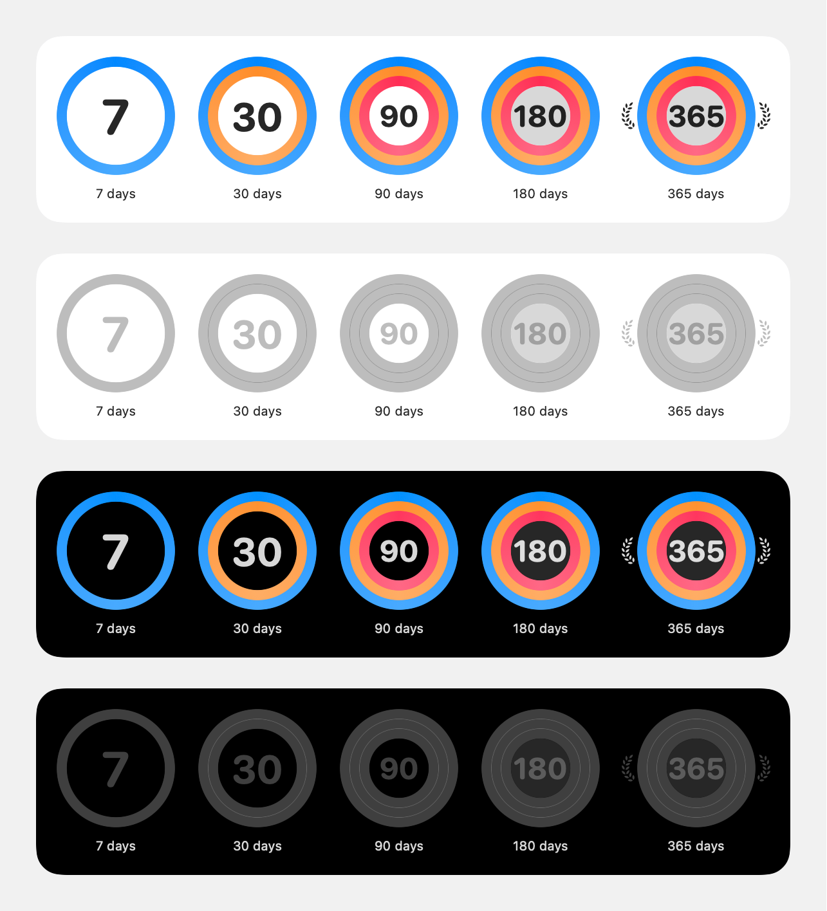

# Streak milestones, phase 1 (2026-11-25)

Branch: `feature/streak-milestones` (from `integration/onboarding-preview` 343aaf16). Not merged.

## Choices
- **Flex day:** bridges the streak without adding to it. If the user logged on the flex day anyway, that day counts like any logged day (+1). One per Monday-Sunday week (fixed Monday, local zone). A marked day wins; otherwise the first settled miss is used. Yesterday and today are never missed (48 hours).
- **Old `createdAt`:** `LogEntry.createdAt` is non-optional, set at creation and preserved by backup export/import, so restored history keeps its real timing and nothing is guessed. Entries edited to an earlier date keep their old `createdAt`, so they do not count (no backfill by editing).
- **Existing long streaks:** the first log after update shows one celebration for the highest badge already earned.
- Flex marks, highest earned and celebrated badge are UserDefaults keys, included in backups (a restore never lowers badges).

## Validation
- `make quality-build` and `make quality-format-check` pass on `feature/streak-milestones`.
- The current image is a SwiftUI `ImageRenderer` render on macOS showing all five earned tiers in light and dark appearance. It is **not** a simulator screenshot. The 180-day center disc and 365-day laurel branches make the upper tiers distinct.
- The requested simulator XCTest and UI validation did **not** complete. The iPhone 17 remained locked by `feature/support-and-ratings UI validation`; the disposable iPhone Air was erased and repaired under its runbook allowance, but Xcode test attempts stopped at `BUILD INTERRUPTED` without executing tests. No simulator screenshots are available yet.

