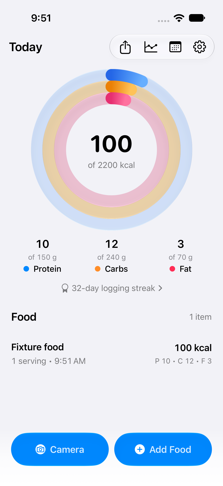
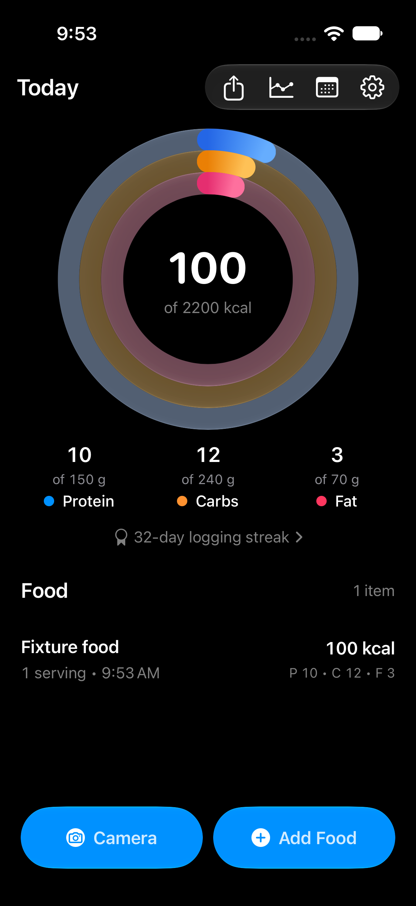
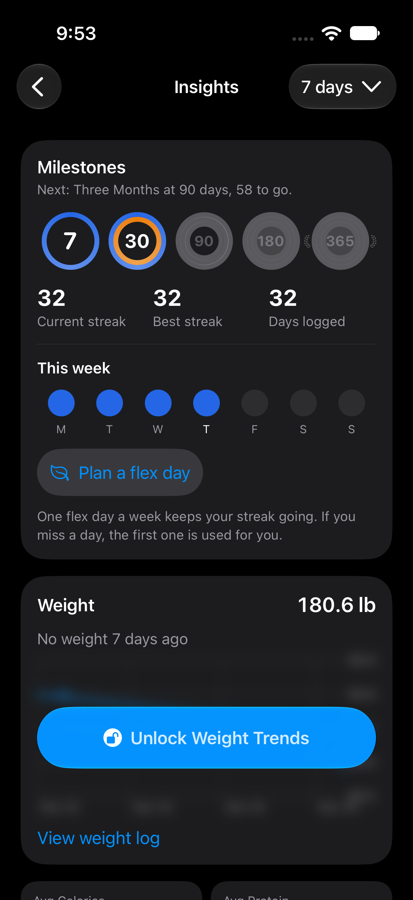
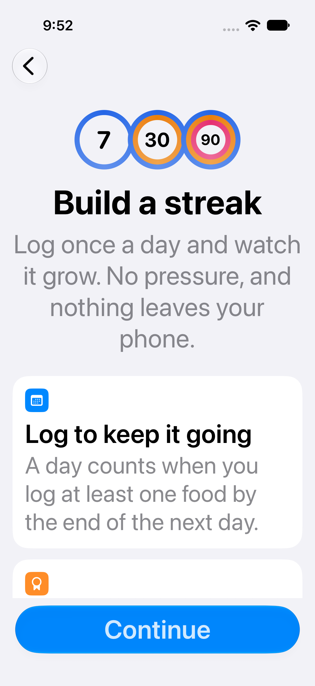

# Streak milestones QA (2026-11-26)

Source: `feature/streak-milestones` at `7e5e75a3` (commit under validation). Xcode 27.0, iOS 27.0, iPhone 17 simulator. QA used isolated fixtures; no production data or service was used.

## Reproduction

From the streak feature worktree, run `xcodebuild -project cal-macro-tracker.xcodeproj -scheme cal-macro-tracker -destination 'platform=iOS Simulator,id=918D29B9-97D3-42C0-9C47-00605E01E8DB' -parallel-testing-enabled NO -test-timeouts-enabled YES -default-test-execution-time-allowance 30 -maximum-test-execution-time-allowance 45 -only-testing:cal-macro-trackerTests/LoggingStreakSummaryTests -only-testing:cal-macro-trackerTests/BackupRoundTripTests test`. The UI scenarios used temporary fixture-backed tests and the same simulator; the test harness was removed after capture. Expected: the scenarios below pass and the listed screens render in light/dark and Accessibility 3.

## Results

- `LoggingStreakSummaryTests`: 22/22 passed.
- `BackupRoundTripTests`: 17/17 passed.
- Three UI scenarios passed: 32-day Today streak badge, Insights milestone/flex-day state, and seven-day celebration after saving a log.
- Onboarding rendered at Accessibility 3 text size. Five captures were visually inspected.
- No blocking cases remained in this validation.

## Captures

- Today streak, light: 
- Today streak, dark: 
- Insights flex day, dark: 
- Insights milestones, dark: 
- Onboarding at Accessibility 3: 

All five selected images are simulator captures and total less than 2 MiB. Raw test results and attachments remain in ignored `build/evidence/2026-11-26-streaks/` in the validation worktree.
