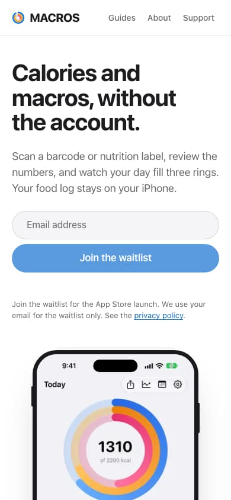
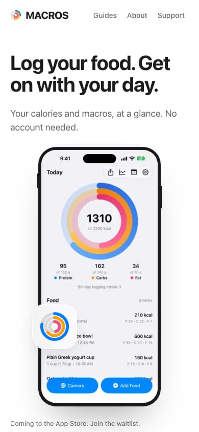
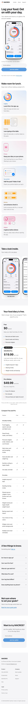
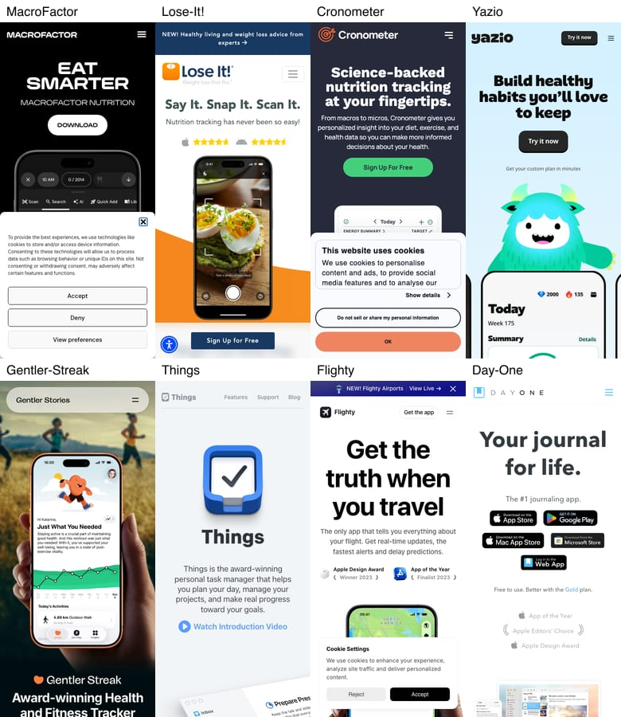

# MACROS website copy evidence

November 5, 2026. Branch `web/copy`, based on `e481272`. Nothing deployed. No simulator or production data touched. Changes are website copy, the hero layout, and two small responsive overflow fixes found during browser checks.

## Result

[Research and decision](../../research/app-website-patterns.md).

- Mobile now reads headline, supporting line, phone, waitlist.
- At 390 × 844, the phone starts at 286.7px instead of 590.5px. Its bottom is 793.6px. The email form starts at 853.0px.
- Desktop keeps the phone beside the copy and signup.
- The App Store flag stays false. The official badge and Smart Banner remain gated by that flag.
- Visible home copy has 886 words before and 718 after, 168 fewer words, a 19.0% cut.
- Hero headline plus supporting copy falls from 29 words to 18.
- Four tracked JPEGs total 423,443 bytes, under 2 MiB.

Word counts use rendered `document.body.innerText` at 390 × 844 after opening all six FAQ disclosures. They include header, comparison table, screenshot captions, FAQ answers, footer, and both form buttons. Scripts, hidden status messages, and image alt text are absent from that text. Removing the clipped honeypot and email labels, skip link, screen-reader table caption, repeated Included/Not included labels, and check/dash symbols gives 886 and 718 visible words. The unfiltered text has 977 and 809 tokens, a 17.2% reduction. The same browser and method count both versions. The hidden secondary desktop navigation adds three words to either version and does not change the reduction.

The local baseline already showed the top of the phone above the fold, unlike the owner's live screenshot. The before capture preserves the actual branch state. No screenshot was changed to mimic the reported layout.

## Lighthouse

Lighthouse 13.6.0, Playwright 1.64.1, Chromium 156.0.8078.4, Bun 1.4.2 on macOS. Built assets served through the local Wrangler Worker at `http://127.0.0.1:8796/`. Mobile uses Lighthouse defaults with simulated throttling. Desktop uses 1440 × 900, 40ms RTT, 10,240 Kbps and 1× CPU.

| Home | Before P / A / BP / SEO | After P / A / BP / SEO | LCP before → after | CLS | TBT |
| --- | --- | --- | --- | --- | --- |
| Mobile | 100 / 100 / 100 / 100 | 100 / 100 / 100 / 100 | 1.361s → 1.437s | 0 → 0 | 0 → 0ms |
| Desktop | 100 / 100 / 100 / 100 | 100 / 100 / 100 / 100 | 0.354s → 0.372s | 0 → 0 | 0 → 0ms |

The mobile phone is now fully visible and uses an appropriate 240px source size. The scores stayed at 100. The small LCP difference is not evidence of a performance improvement. Existing unused-JavaScript and render-blocking advisories remain. These are lab scores, not field INP or conversion results.

## What ran

All final checks passed.

- `bun run check` and `bun run build` in `web/`, zero errors, warnings, or hints.
- Root `make lint-js`, unchanged lint rules.
- Root `git diff --check`.
- `bun docs/evidence/web-og/verify-og.mjs`, seven previews, deterministic clean/repeat builds, isolated title invalidation, no draft leaks, and isolated publication checks. Home title stayed unchanged, so the title assertion needed no edit. The home description changed and its preview hash changed.
- Existing `verifySite` exported by `docs/evidence/web-seo/verify.mjs`, invoked through Playwright against the built Worker. Seven sitemap routes, metadata lengths, canonicals, JSON-LD, exact visible FAQ/schema equality, internal links, hidden drafts/feed, 404, redirects, and honeypot form responses passed.
- Additional browser checks at 320, 390, 768, 900, and 1440 in light and dark. One H1, no document overflow, loaded hero image, mobile image before signup, full phone within the 390px fold, native transition opt-in, header ring logo, and no hero animation under reduced motion all passed.
- Both waitlist forms retain their existing labels and behavior. The hero form rejects empty/invalid email, enables on a valid fixture address, shows keyboard focus, and resets after a mocked success response. No email was sent. The existing SEO verifier uses honeypots, not a real database write.
- About and Support each rendered at 390px with one H1.
- Read the complete diff after validation. No new client JavaScript, dependencies, duplicate forms, or unused badge CSS remain.

The first check caught over-escaped apostrophes introduced during the rewrite. They were corrected before the passing build. The first 320px browser check caught existing header overflow. Navigation padding now tightens below 360px without hiding links or the ring logo. The 900px check caught the existing screenshot track extending 16px beyond the document. It now keeps the mobile gutter margin instead of a larger desktop margin. Both fixes passed the same cases afterward.

An initial attempt to execute Wrangler directly with Bun produced a 503 explaining that Bun ignores its undici dispatcher. Running the repository's `bun run dev:worker` script uses Wrangler's supported executable and passed. No project runtime setting changed.

## Facts checked

Prices match `config/apple/MACROSPro.storekit`: $2.99 monthly, $19.99 yearly, a one-week yearly trial, and $49.99 lifetime. Actual storefront price and eligibility remain Apple's decision.

`Features/Purchases/PaidFeature.swift` and `ProPaywallSheet.swift` confirm the Pro extras. `Features/Scan/Camera/FoodCameraResultPanel.swift` confirms editable servings before logging. `Features/Sharing/SharingScreen.swift` starts sharing disabled and gates sending invites behind Pro. `SharingLocalStateStore.swift` confirms the separate sharing identity. `convex-backend/convex/sharing.ts` sets the seven-day invite lifetime. `sharingModel.ts` and `foodSharing.ts` confirm the snapshot fields and removal of earlier food-sharing days. Existing factual privacy wording is retained in shorter sentences, rather than replaced with a claim that nothing ever leaves the phone.

No app behavior or price is intentionally speculative. The site is still prelaunch. The final launch date and real App Store availability were not asserted or checked. The reference-site feature/outcome counts are manually classified descriptive passages of six or more words, not exhaustive page totals. See the research report for exclusions.

## Repeat locally

Use Bun and frozen dependencies. From this worktree root, run `bun install --frozen-lockfile --cwd web`, then `bun run --cwd web check` and `bun run --cwd web build`. Install the isolated lint package with `bun install --frozen-lockfile --cwd tools/oxlint`, then run `make lint-js` and `git diff --check`.

The optional browser packages stay under ignored `build/seo-tools/`: `bun add --cwd build/seo-tools playwright@1.64.1 lighthouse@13.6.0`, then `bun build/seo-tools/node_modules/playwright/cli.js install chromium`. Start `bun run --cwd web dev:worker --port 8796` in the foreground in another terminal. Import `chromium` from the isolated Playwright package and `verifySite` from `docs/evidence/web-seo/verify.mjs`, then call `verifySite(browser, 'http://127.0.0.1:8796', outputDirectory)`. The verifier is an exported function, not a standalone CLI.

For Lighthouse, use the isolated `lighthouse` package and Playwright Chromium executable. Audit only performance, accessibility, best practices, and SEO with the mobile defaults and desktop settings above. For the copy count, open every `.faq-item`, then count `document.body.innerText.trim().split(/\s+/).length`. For geometry, read `.hero__visual` and `.hero__form` bounds before scrolling. Before scores require the base commit, not the rewritten build.

For the visible count, strip these complete lines from the captured text: Skip to content, Leave this field empty, Email address, Included, Not included, and Features included in Free and in MACROS Pro. Remove checkmark and dash symbols, then split on whitespace. This removes the same 91 non-copy tokens from either version.

Raw audit JSON, browser checks, logs, capture scripts, reference text, and full-size screenshots remain local under ignored `build/evidence/2026-11-05-web-copy/` and `build/seo-tools/`. They are not a durable archive. The four images and this report are the tracked evidence. Larger logs and generated social images were not added to Git.

## Captures

### Before, 390 × 844

### After, 390 × 844

### Full page after

### Eight reference sites, 390 × 844

Each tile is a half-size copy of the real mobile viewport. Cookie notices remain visible.

## Every changed string

Unchanged names, navigation labels, accessible labels, prices, legal text, article copy, form status messages, and table headings remain as they were. The tables below include all changed shared-data strings and all changed inline page/component text. Copy used in metadata is included. Image alt text stays descriptive rather than adopting marketing captions.
### tagline

| String | Before | After |
| --- | --- | --- |
| tagline | Track calories and macros with barcode and label scans, no account. | An iPhone food diary. No account needed. |

### description

| String | Before | After |
| --- | --- | --- |
| description | Track calories and macros on iPhone with MACROS, a food diary with barcode and nutrition label scanners. Log meals on your device with no account required. | MACROS is a calorie counter and macro tracker for iPhone. Keep your food diary on your device, scan a label, and get on with your day. No account needed. |

### hero

| String | Before | After |
| --- | --- | --- |
| hero.title | Calories and macros, without the account. | Log your food. Get on with your day. |
| hero.lead | Scan a barcode or nutrition label, review the numbers, and watch your day fill three rings. Your food log stays on your iPhone. | Your calories and macros, at a glance. No account needed. |

### features

| String | Before | After |
| --- | --- | --- |
| features.0.title | No account. Open it and log. | Lunch first. No sign-up. |
| features.0.body | Nothing to sign up for. Logging works as soon as the app opens. Sharing is optional. | Open the app and start your food diary. |
| features.1.title | Scan a barcode or a nutrition label. | Less typing at the table. |
| features.1.body | One camera view reads both. If a scan misses, type the food in. | Scan the barcode or nutrition label on the pack. |
| features.2.title | Your food log stays on your iPhone. | Keep your diary on your phone. |
| features.2.body | Logs, saved foods, goals, and weight entries are stored on your iPhone, not on our servers. | Your food log lives on your iPhone. Sharing is your choice. |
| features.3.eyebrow | Accuracy | Your portion |
| features.3.title | Review before it counts. | Half the pack? Make it half. |
| features.3.body | Check serving size, quantity, calories, protein, carbs, and fat before an entry joins your day. | Check your portion before you log it. |
| features.4.title | Share your day with your people. | Let someone check in. |
| features.4.body | Sharing is optional and off by default. Invite people with Pro, then choose Nothing, Macros, or Macros + Foods for each person. Connections work while either person has Pro. With Pro, add a widget for someone who shares with you. | Invite someone with Pro, or accept their invite for free. |
| features.5.title | Widgets and Apple Health. | A glance before dinner. |
| features.5.body | See your macros on your Home Screen or Lock Screen. With Pro, follow someone who shares with you in a widget. Nutrition goes to Apple Health if you allow it. | See your daily totals without opening the app. |

### freeFeatures

| String | Before | After |
| --- | --- | --- |
| freeFeatures.0 | All food logging, food search, and barcode and nutrition label scanning | Food logging, search, barcode and label scans |
| freeFeatures.1 | Saved foods and meals, and history | Saved foods, meals, and history |
| freeFeatures.2 | Small and medium Home Screen widgets and a Lock Screen widget | Personal widgets: small, medium, and Lock Screen |
| freeFeatures.3 | Daily share card, and accepting sharing circle invites | Daily share card and accepting invites |
| freeFeatures.4 | Goal calculator and basic weight log | Goal calculator and weight log |
| freeFeatures.5 | Write nutrition to Apple Health | Nutrition writing to Apple Health |

### proFeatures

| String | Before | After |
| --- | --- | --- |
| proFeatures.0 | Insights ranges beyond 7 days | Insights beyond 7 days |
| proFeatures.1 | Sharing circle invites | Sending sharing invites |
| proFeatures.2 | Shared-person Home Screen and Lock Screen widgets | Shared-person widgets: Home Screen and Lock Screen |
| proFeatures.3 | Weight trends and weight import from Apple Health | Weight trends and Apple Health weight import |
| proFeatures.5 | Custom macro ring colors | Your choice of ring colors |
| proFeatures.6 | Custom widget color and photo backgrounds | Widget colors and photo backgrounds |

### plans

| String | Before | After |
| --- | --- | --- |
| plans.0.summary | Everything you need to log every day. | Keep your daily food diary for free. |
| plans.0.highlights.0 | Barcode and label scanning | Barcode and label scans |
| plans.0.highlights.1 | Saved foods, meals, and history | Saved meals and history |
| plans.0.highlights.2 | Widgets and Apple Health writing | Personal widgets |
| plans.1.summary | Adds longer insight ranges, sharing invites, weight trends, and backup. Also $2.99 per month, with no trial. | Look back further with Pro. Or pay $2.99 per month, with no trial. |
| plans.1.highlights.0 | Insights ranges beyond 7 days | Insights beyond 7 days |
| plans.1.highlights.1 | Sharing circle invites | Sharing invites |
| plans.1.highlights.2 | Weight trends, backup, and smart reminders | Weight trends and backup |
| plans.2.summary | Every Pro feature for one payment. It never renews. | Pay once. Keep Pro. |
| plans.2.highlights.0 | All MACROS Pro features | Every Pro feature |
| plans.2.highlights.1 | No subscription | No renewals |

### plansNote

| String | Before | After |
| --- | --- | --- |
| plansNote | Apple shows the price before you buy, and prices and offers can vary by region. | Prices and offers vary by region. Apple confirms the price before you buy. |

### faq

| String | Before | After |
| --- | --- | --- |
| faq.0.question | Do I need an account? | Do I have to sign up? |
| faq.0.answer | No. Food logging works without an account. Sharing is optional and uses a separate sharing profile. | No. You can log food without an account. Optional sharing uses a separate profile. |
| faq.1.question | Is MACROS free? | Can I use it for free? |
| faq.1.answer | Yes. Food logging, food search, barcode and nutrition label scanning, saved foods, history, personal widgets, and Apple Health writing are free. MACROS Pro is optional. | Yes. Logging, search, barcode and label scans, saved foods, history, personal widgets, and writing nutrition to Apple Health are free. Pro is optional. |
| faq.2.question | What is MACROS Pro? | What do I get with Pro? |
| faq.2.answer | Pro adds Insights ranges beyond 7 days, sharing circle invites, shared-person widgets, weight trends, weight import from Apple Health, backup export and import, custom ring colors, custom widget color and photo backgrounds, and multiple or smart reminders. Anyone with your invite link can connect and share back for free until it expires after 7 days or you revoke it. | Pro adds Insights beyond 7 days, sharing invites, shared-person widgets, weight trends, Apple Health weight import, backup export and import, custom ring colors, widget colors and photo backgrounds, and multiple or smart reminders. Anyone with your invite link can connect and share back for free. Links expire after 7 days unless you revoke them sooner. Connections work while either person has Pro. |
| faq.3.question | How much does Pro cost? | What does Pro cost? |
| faq.3.answer | $2.99 per month, $19.99 per year with a 7-day free trial, or $49.99 once for lifetime. Prices vary by region. Apple shows the price before you buy. | $2.99 monthly, $19.99 yearly with a 7-day free trial, or $49.99 for lifetime. Prices vary by region. Apple confirms the price before you buy. |
| faq.4.question | Does it work offline? | Can I log food offline? |
| faq.4.answer | Logging, manual entry, and searching on-device foods work offline. Other food search results and barcode lookup need a connection. | Yes, for logging, manual entry, and searching foods on your device. Other food searches and barcode lookups need a connection. |
| faq.5.question | What leaves my phone? | Does anything leave my phone? |
| faq.5.answer | Search terms or barcodes go to our food-search service. Sharing is optional and off by default. When on, the app sends your display name, optional daily goals, and today’s calories, protein, carbs, fat, and entry count; for each person, choose Nothing, Macros, or Macros + Foods. Food sharing includes today’s food names, amounts, calories, protein, carbs, and fat, but never logged times, notes, photos, or barcodes. Foods are uploaded only while at least one person can see them; foods are deleted when sharing them stops, and older days are deleted. Viewers see today only. | Search terms and barcodes go to our food-search service. Sharing starts off. Turn it on to send your display name, optional goals, and today's calories, protein, carbs, fat, and entry count. Choose Nothing, Macros, or Macros + Foods for each person. Shared foods include today's names, amounts, and nutrients, never logged times, notes, photos, or barcodes. Foods upload only while someone can see them and are deleted when food sharing stops. Older days are deleted. People see today only. |

### heroShowcase

| String | Before | After |
| --- | --- | --- |
| heroShowcase.alt | MACROS dashboard with a full day logged, macro goals, and a centered streak | MACROS food diary with calorie and macro rings above today's meals |

### screenshots

| String | Before | After |
| --- | --- | --- |
| screenshots.0.title | Today’s food and macros | Your day so far |
| screenshots.1.title | Search foods in one list | Find your usual |
| screenshots.2.title | Review a label scan | Check the portion |
| screenshots.3.title | Edit details in the camera | Fix a scan |
| screenshots.4.title | Daily history | What was lunch yesterday? |
| screenshots.5.title | Weight and nutrition trends (Pro) | Look back with Pro |
| screenshots.6.title | Share with your people | Check in with your people |
| screenshots.7.title | What Alex shares | See Alex's day |
| screenshots.8.title | Your macros and Alex’s (Pro) | Your totals. Alex's with Pro. |
| screenshots.9.title | Settings and goals | Set your own goals |

### Inline home sections

| Section | Before | After |
| --- | --- | --- |
| Hero launch line | Included in the longer privacy note below | Coming to the App Store. Join the waitlist. |
| Hero privacy note | Join the waitlist for the App Store launch. We use your email for the waitlist only. See the privacy policy. | Your email is only for the waitlist. Privacy policy. |
| Feature heading | Log fast. Check the numbers. Keep your data. | Make room for lunch. |
| Feature supporting line | Quick logging, with every number in view. | Keep track without making a project of it. |
| Screenshot heading | See a day in MACROS. | Take a look inside. |
| Screenshot supporting line | From the first scan to the daily share card. | Your meals, all in one place. |
| Plans heading | Free to track. Pro when you want more. | Your food diary is free. |
| Plans supporting line | Everyday tracking is free. Pro adds longer insights, weight trends, and backup. | Want a longer view of your progress? That's what Pro is for. |
| FAQ heading | Common questions. | A few things to know. |
| FAQ supporting line and link | Not answered here? Ask support. | Something else? Ask us. |
| Guide heading | Start with goals you understand. | Not sure where to set your goals? |
| Guide supporting line | See the math behind daily targets, and what the app's presets mean. | Here's how the app works them out. |
| Guide link | How to set protein, carb, and fat goals | Read the macro goals guide |
| Waitlist heading | Be there when MACROS launches. | Want to try MACROS? |
| Waitlist supporting line | Join the waitlist for the App Store release. | Join the waitlist. We'll email you when it's on the App Store. |
| Footer blurb | MACROS: Nutrition Tracker is an iPhone app for calories and macros. Track calories and macros with barcode and label scans, no account. | An iPhone food diary. No account needed. |

The shared waitlist wording also appears on About. The shared footer blurb appears on every page. Legal body text and the guide article were not edited.

### About and Support intros

| Section | Before | After |
| --- | --- | --- |
| About heading | Simple, accurate daily tracking. | A food diary you can just open. |
| About intro | MACROS: Nutrition Tracker is the App Store name. In the app it is MACROS, an iPhone calorie and macro tracker that stores your log on the device. | MACROS is an iPhone calorie and macro tracker. Log what you ate, check your day, and get back to it. Your diary stays on your phone. |
| Support heading | Need help with the app? | Something not working? |
| Support intro | Send your name, email, and a short description of the problem. We store the request so we can answer it. | Tell us what happened. Leave your name and email so we can reply. We keep your request to help you with it. |
