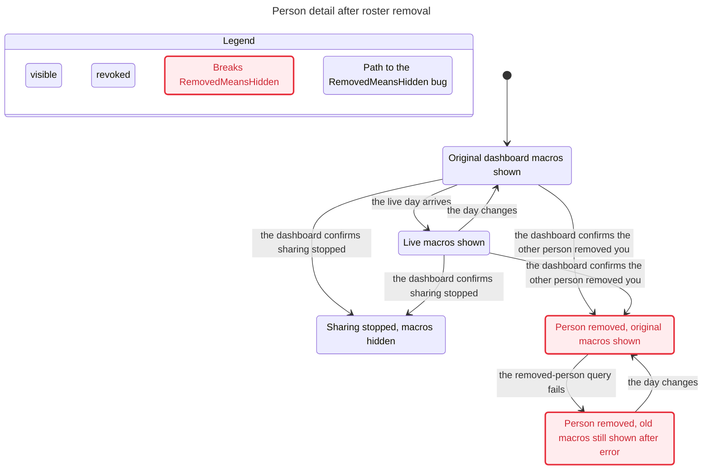

# SPEC

TLC reached 17 states and 55 steps. The chart draws 5 states and 8 arrows.
The chart does not draw 37 steps that stay in one chart state.

## RemovedMeansHidden breaks
The shortest path has 1 step:
0. Original dashboard macros shown
1. the dashboard confirms the other person removed you: Person removed, original macros shown

## Rules that hold
TypeOK, NotSharedMeansHidden, NoDeadlock

## Interpretation and source replay

**Confirmed source conflict F3. RemovedMeansHidden breaks at step 1.**

Reachable / representable control states: **17 / 288**. Products and count conventions are in the [inventory](../README.md#counting-rules).

[F3 source replay](../FINDINGS.md#f3-removed-relationship-revives-the-detail-screens-original-snapshot) follows roster absence, cache pruning, original-person fallback, and subsequent query error. It concerns previously fetched data, not a new unauthorized backend read.

### Reader rules

RemovedMeansHidden: authoritative removal hides that person's macros. NotSharedMeansHidden: an explicit not-shared reply hides the snapshot. TypeOK, NotSharedMeansHidden and NoDeadlock hold.

### Abstraction and omissions

One detail screen opened with an original snapshot, one person, visible/removed/notShared roster buckets, and two day attempts. The original payload is represented by presence only. No foods payload, provisional empty roster before first authoritative dashboard, Pro pause details, or arbitrary navigation. Old replies are modeled as canceled and ignored, matching the explicit cancellation guard.

The view hides no explicit actions. Statechart omits steps that stay in one chart label; the checked model still contains them. Parallel-region charts display changed regions only. See the generated header above for counts.

### Proposed explicit boundary, not implemented

PersonAvailability: loading, available(person, day), paused, notShared, removed, failed(lastGood?). Membership absence after an authoritative roster is a terminal unavailable outcome, not a fallback to the captured initial person.

## Chart

[Exact regeneration](RUN.md). All failures above are model results; only the separately replayed source conflicts are classified as confirmed defects. Owner approval remains pending.
