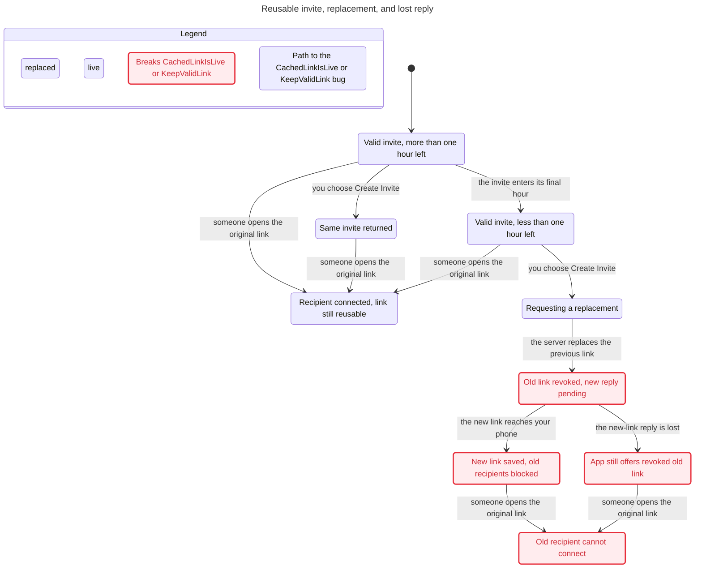

# SPEC

TLC reached 12 states and 22 steps. The chart draws 9 states and 11 arrows.
The chart does not draw 10 steps that stay in one chart state.

## KeepValidLink breaks
The shortest path has 3 steps:
0. Valid invite, more than one hour left
1. the invite enters its final hour: Valid invite, less than one hour left
2. you choose Create Invite: Requesting a replacement
3. the server replaces the previous link: Old link revoked, new reply pending

## CachedLinkIsLive breaks
The shortest path has 4 steps:
0. Valid invite, more than one hour left
1. the invite enters its final hour: Valid invite, less than one hour left
2. you choose Create Invite: Requesting a replacement
3. the server replaces the previous link: Old link revoked, new reply pending
4. the new-link reply is lost: App still offers revoked old link

## Rules that hold
TypeOK, AcceptanceDoesNotConsume, NoDeadlock

## Interpretation and source replay

**Confirmed source conflict F4. KeepValidLink breaks at step 3; CachedLinkIsLive breaks at step 4.**

Reachable / representable control states: **12 / 128**. Products and count conventions are in the [inventory](../README.md#counting-rules).

[F4 source replay](../FINDINGS.md#f4-a-valid-invite-is-replaced-early-and-a-lost-reply-leaves-the-revoked-link-cached) explains final-hour replacement and lost reply. Both marks can occur on the cached-old-link state; the shortest paths identify which rule first breaks.

### Reader rules

KeepValidLink: Create Invite preserves the existing valid link until expiry or explicit revoke. CachedLinkIsLive: the offered current link is not already replaced. AcceptanceDoesNotConsume: accepting a reusable live link leaves it pending. TypeOK, acceptance and NoDeadlock hold.

### Abstraction and omissions

One owner, one old link, one replacement; time buckets fresh/final hour, both unexpired. No natural expiry, explicit revoke, concurrent create callers, quotas, or token entropy. KeepValidLink is intentionally scoped to this unexpired/no-explicit-revoke execution; do not apply it after adding expiry without its condition. AcceptanceDoesNotConsume encodes the reusable-link contract, not all relationship directions.

The view hides no explicit actions. Statechart omits steps that stay in one chart label; the checked model still contains them. Parallel-region charts display changed regions only. See the generated header above for counts.

### Proposed explicit boundary, not implemented

InviteState: none, valid(link), revoking, creating(operationID), reconciling, failed. Preserve the approved validity contract and reconcile uncertain create outcomes before advertising cached state.

## Chart

[Exact regeneration](RUN.md). All failures above are model results; only the separately replayed source conflicts are classified as confirmed defects. Owner approval remains pending.
