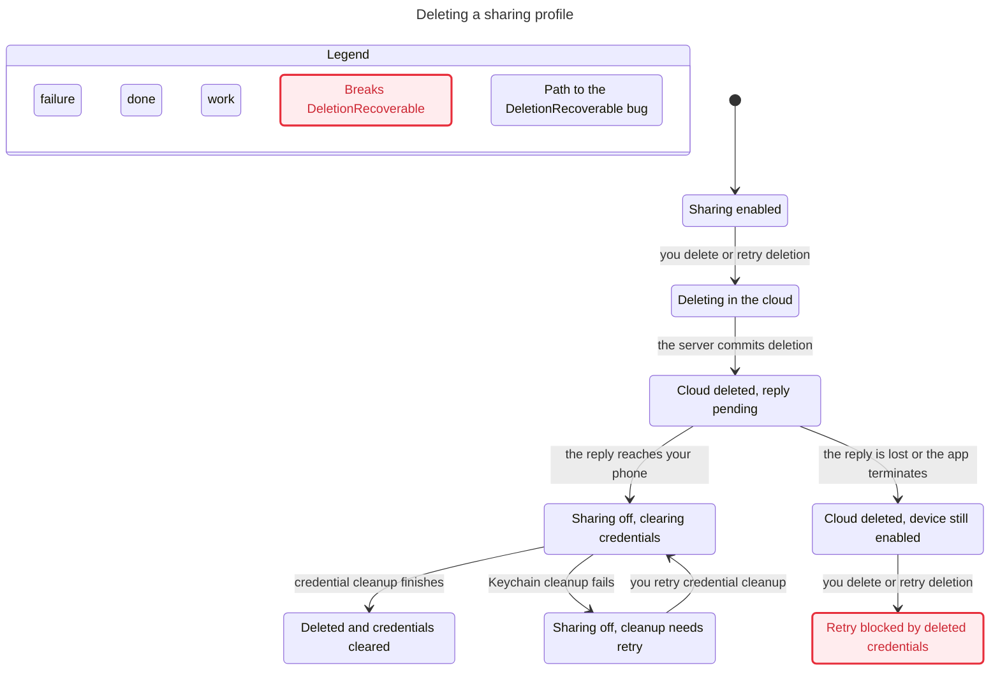

# SPEC

TLC reached 8 states and 10 steps. The chart draws 8 states and 8 arrows.
The chart does not draw 2 steps that stay in one chart state.

## DeletionRecoverable breaks
The shortest path has 4 steps:
0. Sharing enabled
1. you delete or retry deletion: Deleting in the cloud
2. the server commits deletion: Cloud deleted, reply pending
3. the reply is lost or the app terminates: Cloud deleted, device still enabled
4. you delete or retry deletion: Retry blocked by deleted credentials

## Rules that hold
TypeOK, MarkerFollowsRemoteDeletion, NoDeadlock

## Interpretation and source replay

**Confirmed source conflict F1. DeletionRecoverable breaks at path step 4.**

Reachable / representable control states: **8 / 84**. Products and count conventions are in the [inventory](../README.md#counting-rules).

[F1 source replay](../FINDINGS.md#f1-deletion-acknowledgment-is-the-only-doorway-to-local-cleanup) maps every step to client authentication, server tombstoning, acknowledgment loss, and retry. No runtime reproduction was run.

### Reader rules

DeletionRecoverable: Retry must still be able to finish credential cleanup. MarkerFollowsRemoteDeletion: the cleanup marker follows remote deletion acknowledgment. TypeOK and NoDeadlock hold; only DeletionRecoverable breaks.

### Abstraction and omissions

One identity and one delete request; network commit/acknowledgment split; one abstract cleanup error. Does not model every Keychain error, OS file-protection state, backend batch stage, or widget credential migration. The local cleanup state represents the persisted cleanup marker; MarkerFollowsRemoteDeletion checks marker ordering, not actual UI or all device-sharing flags.

The view hides no explicit actions. Statechart omits steps that stay in one chart label; the checked model still contains them. Parallel-region charts display changed regions only. See the generated header above for counts.

### Proposed explicit boundary, not implemented

Persisted DeletionState: active, requested(operationID), remoteDeleted, cleaning, cleanupFailed, off. A pure transition returns the next journal state and authentication/deletion/cleanup effects. Reconciliation must distinguish an unknown remote result from a verified deletion.

## Chart

[Exact regeneration](RUN.md). All failures above are model results; only the separately replayed source conflicts are classified as confirmed defects. Owner approval remains pending.
