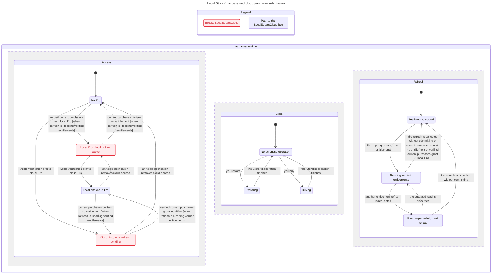

# SPEC

TLC reached 72 states and 399 steps. The chart draws 10 states and 17 arrows.
The chart does not draw 99 steps that stay in one chart state.
The step current purchases contain no entitlement changes Access and Refresh at the same time.
The step verified current purchases grant local Pro changes Access and Refresh at the same time.

## LocalEqualsCloud breaks
The shortest path has 2 steps:
0. Access No Pro, Store No purchase operation, Refresh Entitlements settled
1. the app requests current entitlements: Access No Pro, Store No purchase operation, Refresh Reading verified entitlements
2. verified current purchases grant local Pro: Access Local Pro, cloud not yet active, Store No purchase operation, Refresh Entitlements settled

## Rules that hold
TypeOK, OnePurchaseOperation, NoDeadlock

## Interpretation and source replay

**LocalEqualsCloud breaks at step 2 and is dismissed as an invalid instantaneous-equality rule. No confirmed payment bug.**

Reachable / representable control states: **72 / 144**. Products and count conventions are in the [inventory](../README.md#counting-rules).

[Dismissed equality diagnostic](../FINDINGS.md#dismissed-model-only-failures-and-prevented-paths): verified StoreKit facts unlock local Pro before optional sharing-backend submission. Local and cloud authority intentionally converge asynchronously and can differ offline.

### Reader rules

OnePurchaseOperation: buy and restore cannot overlap. LocalEqualsCloud is retained as a deliberately rejected diagnostic, not weakened to pass. TypeOK, OnePurchaseOperation and NoDeadlock hold.

### Abstraction and omissions

One Boolean local fact and one Boolean backend fact, one abstract transaction/submission, refresh idle/reading/dirty. No product catalog/pending-purchase UI, transaction chronology, grace-period dates, family sharing, five-profile link cap, duplicate JWS handling, or full notification verification. Backend revocation is independent of local refresh. No eventual-consistency liveness theorem.

The view hides no explicit actions. Statechart omits steps that stay in one chart label; the checked model still contains them. Parallel-region charts display changed regions only. See the generated header above for counts.

### Proposed explicit boundary, not implemented

Independent PurchaseOperation, EntitlementRefresh and SubmissionState regions. Derive VerifiedEntitlements from StoreKit facts; keep cloud coverage and persisted widget access separate rather than constructing a single paid/unpaid enum.

## Chart

[Exact regeneration](RUN.md). All failures above are model results; only the separately replayed source conflicts are classified as confirmed defects. Owner approval remains pending.
