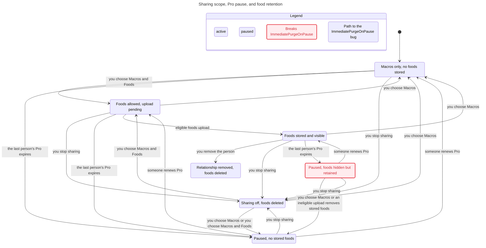

# SPEC

TLC reached 10 states and 66 steps. The chart draws 7 states and 20 arrows.
The chart does not draw 34 steps that stay in one chart state.
The view hides 9 steps, so the chart does not draw them.

## ImmediatePurgeOnPause breaks
The shortest path has 3 steps:
0. Macros only, no foods stored
1. you choose Macros and Foods: Foods allowed, upload pending
2. eligible foods upload: Foods stored and visible
3. the last person's Pro expires: Paused, foods hidden but retained

## Rules that hold
TypeOK, NoUnauthorizedRead, NoDeadlock

## Interpretation and source replay

**ImmediatePurgeOnPause breaks at step 3. This is owner policy question Q1, not a confirmed unauthorized-read bug.**

Reachable / representable control states: **10 / 24**. Products and count conventions are in the [inventory](../README.md#counting-rules).

[Q1 source replay](../FINDINGS.md#q1-does-pausing-for-pro-expiry-require-immediate-physical-food-deletion): scope reduction removes food data, queries gate access, and Pro expiry recomputes status without an immediate food purge.

### Reader rules

NoUnauthorizedRead: only an eligible live foods grant can expose foods. ImmediatePurgeOnPause: food bytes disappear as soon as neither person has Pro, an unapproved stronger policy. TypeOK, NoUnauthorizedRead and NoDeadlock hold.

### Abstraction and omissions

One directed connection, one food payload and Boolean effective Pro. Assumes deployment Pro gating is enabled; production settings were not queried. No grant-history dates, multiple recipients, quota failures or cleanup delay. VisibleFoods directly transcribes read gates, so NoUnauthorizedRead is not an independent security proof. Relationship removal is terminal; no reconnect transition.

The view suppresses all YouRemovePerson arrows except the complete Foods stored and visible → Relationship removed, foods deleted arrow. Nine model steps are hidden, not unchecked. All chart states remain reachable; the disconnected state has no nonstuttering outgoing model transition. Same-label steps are also omitted by statechart.

### Proposed explicit boundary, not implemented

ConnectionAccess and RetentionState as separate regions. First decide whether paused foods are retained or purged, then add an explicit policy-driven purge transition if required.

## Chart

[Exact regeneration](RUN.md). All failures above are model results; only the separately replayed source conflicts are classified as confirmed defects. Owner approval remains pending.
