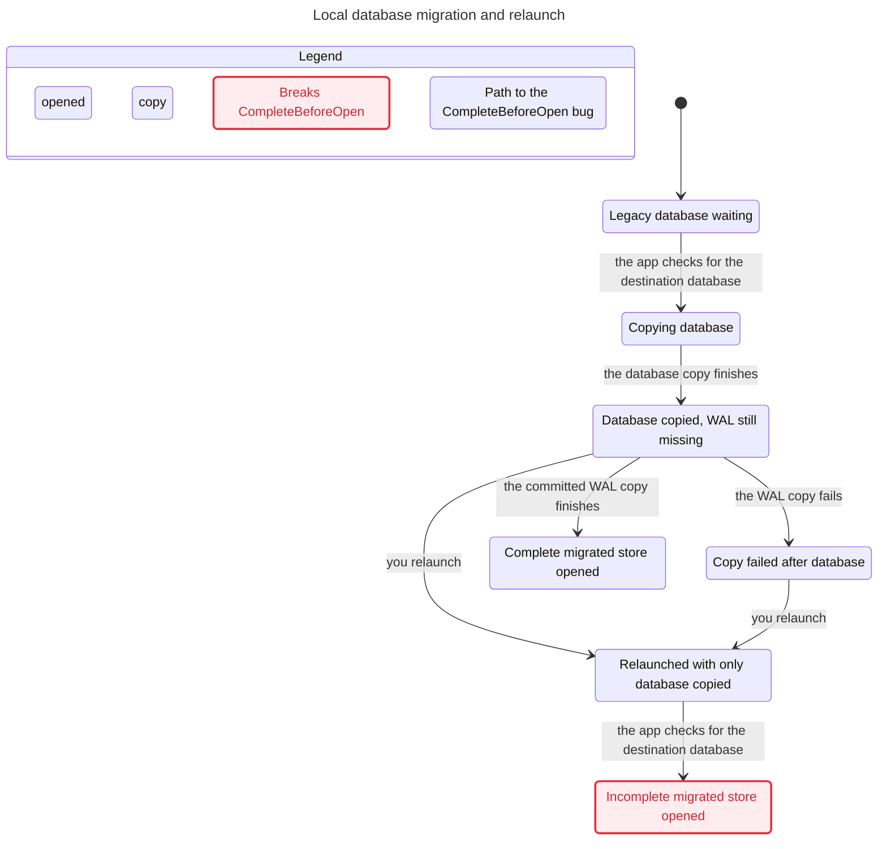

# SPEC

TLC reached 7 states and 9 steps. The chart draws 7 states and 7 arrows.
The chart does not draw 2 steps that stay in one chart state.

## CompleteBeforeOpen breaks
The shortest path has 4 steps:
0. Legacy database waiting
1. the app checks for the destination database: Copying database
2. the database copy finishes: Database copied, WAL still missing
3. you relaunch: Relaunched with only database copied
4. the app checks for the destination database: Incomplete migrated store opened

## Rules that hold
TypeOK, NoDeadlock

## Interpretation and source replay

**Confirmed conditional source conflict F2. CompleteBeforeOpen breaks at path step 4.**

Reachable / representable control states: **7 / 20**. Products and count conventions are in the [inventory](../README.md#counting-rules).

[F2 source replay](../FINDINGS.md#f2-a-partially-copied-sqlite-store-is-treated-as-migrated) maps check/copy/interruption/relaunch/open to source. Requires a source WAL holding committed uncheckpointed data. No observed data loss or app fixture run.

### Reader rules

CompleteBeforeOpen: an opened migrated store includes all committed legacy data. TypeOK and NoDeadlock hold; CompleteBeforeOpen breaks.

### Abstraction and omissions

One source with committed WAL data, one destination, one interruption boundary. SHM is omitted because the persistent-state rule concerns base plus WAL. Does not establish that copying an actively changing source is a consistent snapshot. Original legacy artifacts are not deleted.

The view hides no explicit actions. Statechart omits steps that stay in one chart label; the checked model still contains them. Parallel-region charts display changed regions only. See the generated header above for counts.

### Proposed explicit boundary, not implemented

MigrationState: legacy, preparing, copiedAndValidated, published, failed. Use a consistent database snapshot protocol and staged publication with durable recovery, rather than a base-file-exists guard.

## Chart

[Exact regeneration](RUN.md). All failures above are model results; only the separately replayed source conflicts are classified as confirmed defects. Owner approval remains pending.
