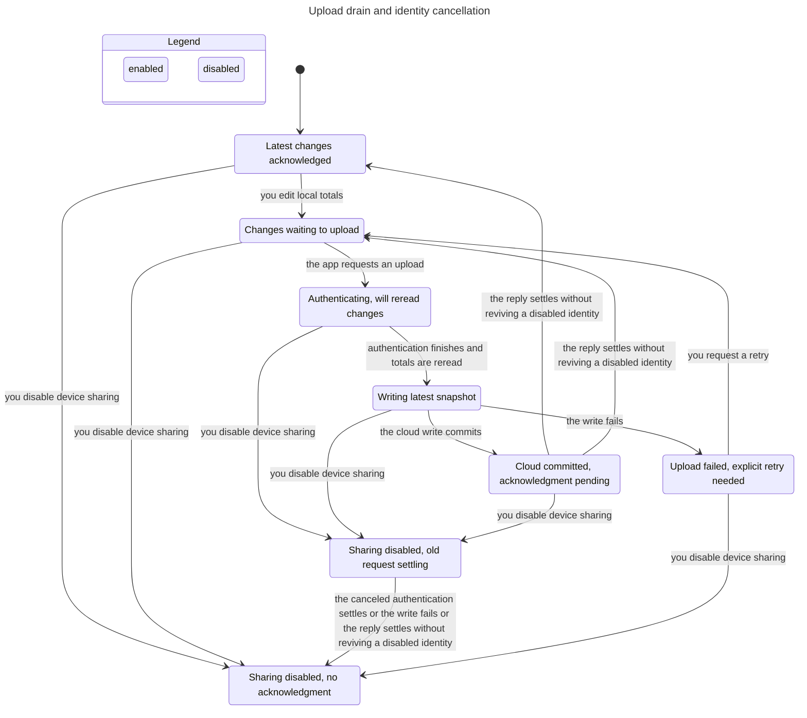

# SPEC

TLC reached 66 states and 167 steps. The chart draws 8 states and 15 arrows.
The chart does not draw 88 steps that stay in one chart state.

## Rules that hold
TypeOK, NoStaleAcknowledgment, NoLostEdit, NoDeadlock

## Interpretation and source replay

**No configured invariant failure. This is bounded support for existing guards, not proof of all upload behavior.**

Reachable / representable control states: **66 / 6,480**. Products and count conventions are in the [inventory](../README.md#counting-rules).

[Prevented paths](../FINDINGS.md#dismissed-model-only-failures-and-prevented-paths): SharingSyncService.swift:134–210 coalesces requests, re-reads after authentication and fences completion by identity/attempt. Remote commit can still precede local cancellation; that is explicitly allowed.

### Reader rules

NoStaleAcknowledgment: disabling prevents an old local success acknowledgment. NoLostEdit: a successful settled enabled drain cannot have an unacknowledged edit without dirty work. TypeOK and NoDeadlock also hold.

### Abstraction and omissions

Two edits (revision 0→1→2), including an edit while a previous revision is in flight, two generations, no re-enable after disable, a single request slot and one abstract failure. Does not model arbitrary sequences of edits, payload hashing collisions, food-payload retention, day changes, process-restored uploading metadata, or backend delivery guarantees. No fairness/eventual-success claim.

The view hides no explicit actions. Statechart omits steps that stay in one chart label; the checked model still contains them. Parallel-region charts display changed regions only. See the generated header above for counts.

### Proposed explicit boundary, not implemented

UploadState(attemptID, identityGeneration, requestedRevision, sentRevision, phase) with pure request/edit/settle transitions. Keep remote side effects outside the reducer and preserve the distinction between committed cloud writes and local acknowledgment.

## Chart

[Exact regeneration](RUN.md). All failures above are model results; only the separately replayed source conflicts are classified as confirmed defects. Owner approval remains pending.
