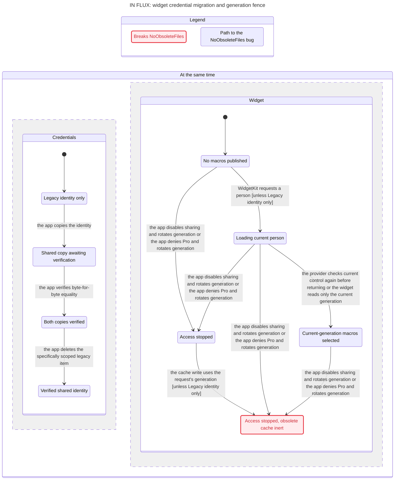

# SPEC

TLC reached 69 states and 355 steps. The chart draws 9 states and 10 arrows.
The chart does not draw 243 steps that stay in one chart state.

## NoObsoleteFiles breaks
The shortest path has 5 steps:
0. Credentials Legacy identity only, Widget No macros published
1. the app copies the identity: Credentials Shared copy awaiting verification, Widget No macros published
2. WidgetKit requests a person: Credentials Shared copy awaiting verification, Widget Loading current person
3. the response passes the first current-control check: Credentials Shared copy awaiting verification, Widget Loading current person
4. the app disables sharing and rotates generation: Credentials Shared copy awaiting verification, Widget Access stopped
5. the cache write uses the request's generation: Credentials Shared copy awaiting verification, Widget Access stopped, obsolete cache inert

## Rules that hold
TypeOK, PreserveIdentity, OnlyCurrentDataSelected, NoDeadlock

## Interpretation and source replay

**IN FLUX. NoObsoleteFiles breaks at step 5 and is dismissed. PreserveIdentity and OnlyCurrentDataSelected hold for the bounded success/checkpoint abstraction.**

Reachable / representable control states: **69 / 3,072**. Products and count conventions are in the [inventory](../README.md#counting-rules).

[Dismissed widget diagnostic](../FINDINGS.md#dismissed-model-only-failures-and-prevented-paths): prewrite current-control check passes, app rotates generation, then old-generation disk write lands. Generation/person/day-keyed reads make it inert; final current-control check rejects the old response.

### Reader rules

PreserveIdentity: retain the legacy identity or a verified shared copy. OnlyCurrentDataSelected: logical current-control selection cannot use disabled, denied or obsolete-generation data. NoObsoleteFiles is an intentionally overstrong physical-cleanup diagnostic. TypeOK and NoDeadlock hold.

### Abstraction and omissions

Success-only legacy→shared identity migration, one request, two generations, Boolean Pro, one cache generation. Does not model Keychain errors/duplicate query selection, migration-error latch, token exchange ownership, people/default/day changes, Pro unknown, offline status taxonomy, or midnight timelines. Those are inventory follow-ups, not proven safe here. selected means logical eligibility at control checkpoints; invalidation revokes it in the abstraction. It is NOT physical WidgetKit presentation. Already-rendered entries, OS refresh timing and the last-check-to-return race are outside this model.

The view hides no explicit actions. Statechart omits steps that stay in one chart label; the checked model still contains them. Parallel-region charts display changed regions only. See the generated header above for counts.

### Proposed explicit boundary, not implemented

CredentialMigrationState, immutable WidgetLoadContext and WidgetOutcome remain separate. Use generation-scoped cache and token ownership; do not infer instantaneous widget redaction from a control write.

## Chart

[Exact regeneration](RUN.md). All failures above are model results; only the separately replayed source conflicts are classified as confirmed defects. Owner approval remains pending.
