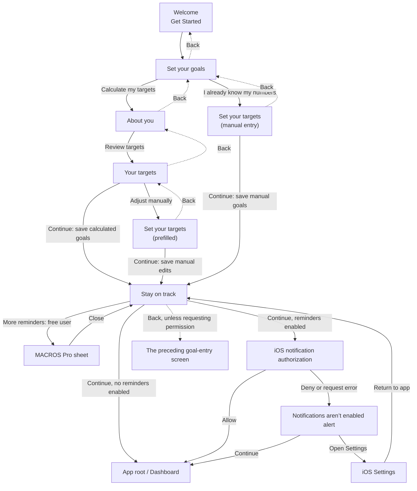

# MACROS onboarding and Dashboard tutorial

Source references below are from `origin/release/1.1`. Screenshots were captured on the disposable iPhone 17 simulator at 9:41, in light mode. See the capture notes at the end for the one system alert that could not be reproduced.

## Onboarding navigation

The flow is a `NavigationStack`: Welcome is the root and hides its back button. **Get Started** appends `choice`; the two rows on **Set your goals** branch to `aboutYou` and a directly pushed `GoalSetupScreen`, respectively. In the calculated branch, **Review targets** pushes the review screen; **Adjust manually** pushes `GoalSetupScreen` prefilled with the current estimate. Standard navigation back buttons pop to the previous screen, so the prefilled manual editor returns to target review, and manual entry returns to the choice screen. (Source: `cal-macro-tracker/Features/Onboarding/OnboardingFlow.swift:5-42,89-95,126-157`; `cal-macro-tracker/Features/Onboarding/BodyProfileFormScreen.swift:158-271`; `cal-macro-tracker/Features/Onboarding/TargetReviewScreen.swift:39-61,110-141`.)

**About you** presents Sex (Female, Male, Unspecified), Age, Height, Weight, Height units (cm or ft/in), Activity level (Sedentary, Light, Moderate, Active, Very active), and goal direction (Lose, Maintain, Gain). Weekly pace appears only for Lose/Gain. (Source: `cal-macro-tracker/Features/Onboarding/BodyProfileFormScreen.swift:158-271,133-155`; `cal-macro-tracker/Features/Onboarding/GoalCalculator.swift:3-30`.)

**Review targets** shows the calculated calorie and macro targets, a Macro balance picker (Balanced, High protein, Higher fat), safety/medical copy when applicable, **Adjust manually**, and **Continue**. Continue saves the profile and goals before moving to reminders. **Set your targets** has editable calories, protein, carbs, and fat fields; Continue saves them, and saves the body profile when invoked from the calculated branch. The editor has a standard navigation Back destination to its caller. (Source: `cal-macro-tracker/Features/Onboarding/TargetReviewScreen.swift:76-141,162-179`; `cal-macro-tracker/Features/Onboarding/GoalCalculator.swift:50-57`; `cal-macro-tracker/Features/Onboarding/GoalSetupScreen.swift:65-129,146-165`.)

**Stay on track** defaults to one Daily reminder enabled at 9:00 AM and offers its time picker. **More reminders** is a Pro upsell for free users; Pro users can enable Breakfast, Lunch, Dinner, and Evening check-in, subject to the three-reminder limit, with time pickers for the first three. Back returns to the prior goal-entry path unless the app is currently requesting permission. (Source: `cal-macro-tracker/Features/Onboarding/OnboardingFlow.swift:182-266,315-412,430-496`.)

Both goal-entry branches pass `completeGoalSetup` as their completion closure. That closure appends `reminders`; it does **not** yet finish onboarding. On **Stay on track**, **More reminders** opens the Pro paywall for a non-Pro user (Pro users see the reminder toggles inline). Continue saves reminder choices. With no enabled reminder it finishes directly; with reminders enabled it checks notification status, and requests authorization only when status is not determined. An authorized/provisional result finishes. Denial, request error, or unsupported/ephemeral status displays the in-app **Notifications aren’t enabled** alert, where **Continue** finishes or **Open Settings** opens iOS Settings. The final callback reaches the app and sets `hasCompletedGoalSetup = true`, replacing onboarding with the app root. (Source: `cal-macro-tracker/Features/Onboarding/OnboardingFlow.swift:15-34,182-266,332-345,430-496`; `cal-macro-tracker/cal_macro_trackerApp.swift:84-96,205-226`.)

## Dashboard tutorial

The tutorial starts when the dashboard has reported nonempty geometry for its rings, macro legend, content area, and bottom bar, the navigation path and sheet are empty, and `hasCompletedDashboardTutorial` is false. Each step accepts only the action it describes. The first two captions share progress step 1; the next two share step 2; ring expansion is step 3; macro selection and completion are step 4. (Source: `cal-macro-tracker/Features/Dashboard/Tutorial/DashboardTutorial.swift:27-53,118-137`; `cal-macro-tracker/App/AppRootView.swift:118-129,177-179`.)

| Order | Step and caption | Advancing action | Caption action button |
| --- | --- | --- | --- |
| 1 | **See your sharing circle** — “Swipe left on your rings to open Sharing.” | Swipe left on rings, or the guided action pushes Sharing. | “Open Sharing” for accessibility/reduced-motion; otherwise **Do it for me**. |
| 2 | **Your sharing circle** — “People who share with you show their rings here. Swipe right from the edge or tap Back to return.” | Return to the dashboard using Back or the edge swipe. | “Back to Dashboard” for accessibility/reduced-motion; otherwise **Do it for me**. |
| 3 | **Look back** — “Swipe right on your rings to see yesterday.” | Swipe right on rings, selecting the previous day. | “Show Yesterday” for accessibility/reduced-motion; otherwise **Do it for me**. |
| 4 | **Back to today** — “Tap Today to come back.” | Tap the Today pill, or the guided action returns to today. | “Go to Today” for accessibility/reduced-motion; otherwise **Do it for me**. |
| 5 | **Tap for more** — “Tap the rings to make them bigger and see more nutrition details.” | Tap the ring panel to expand it. | “Expand Rings” for accessibility/reduced-motion; otherwise **Do it for me**. |
| 6 | **Focus on a macro** — “Tap Protein.” | Select Protein in the macro legend. | “Select Protein” for accessibility/reduced-motion; otherwise **Do it for me**. |
| 7 | **Focus on a macro** — “Tap Carbs.” | Select Carbs in the macro legend. | “Select Carbs” for accessibility/reduced-motion; otherwise **Do it for me**. |
| 8 | **Focus on a macro** — “Tap Fat.” | Select Fat in the macro legend. | “Select Fat” for accessibility/reduced-motion; otherwise **Do it for me**. |
| 9 | **You’re all set** — “Log your first food with Camera or Add Food.” | Tap **Done** on the completion card. | No caption action button; the completion card has **Done**. |

Macro prompts appear in the `MacroMetric.allCases` order: Protein, Carbs, Fat. The normal caption card also has **Skip**, which dismisses any active step; the completion card replaces it and offers **Done**. Dismissal marks the tutorial complete. Settings → **Show Dashboard Tips** clears that completion flag; returning to the root dashboard makes the tutorial eligible to start again. (Source: `cal-macro-tracker/Shared/MacroMetric.swift:3-18`; `cal-macro-tracker/Features/Dashboard/Tutorial/DashboardTutorial.swift:72-105,143-176`; `cal-macro-tracker/Features/Dashboard/Tutorial/TutorialCaptionCard.swift:72-94,98-148`; `cal-macro-tracker/Features/Dashboard/DashboardScreen.swift:92-100,307-315,375-381,421-450`; `cal-macro-tracker/App/AppRootView.swift:118-129,177-179`; `cal-macro-tracker/Features/Settings/SettingsScreen.swift:85-88`.)

## Capture notes

- 21 primary PNGs cover the welcome/choice screens, both goal-entry branches (including scrolled states), reminder defaults and scrolled content, Pro paywall, all tutorial steps, and the Skip control. Images are downscaled to a maximum dimension of 1300 px. A 22nd, pending-permission screen capture is retained separately and explicitly is not the iOS alert.
- The iOS notification authorization alert was **not captured**. On this simulator, MACROS already had a persisted notification authorization state before this run. `simctl privacy reset all` does not include notification authorization, and uninstalling the app did not restore the prompt. `onb-07-reminder-request-pending.png` records the app screen after Continue instead; it is not the iOS alert.
- The captured Sharing view is the empty-state Sharing dashboard with the “Your sharing circle” tutorial caption, because this clean install had no linked sharing people.
- No app source changes are part of the delivery. The one-off UI test used to capture screenshots was removed before committing.
